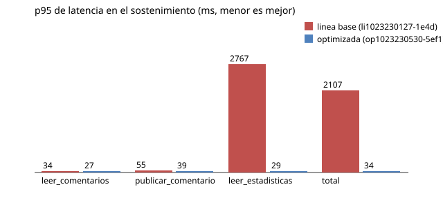

# Comparación: línea base vs optimizada

Generado por `scripts/comparar.py` el 2026-10-23T23:07:16-03:00. Los números salen de `resultados_linea_base.json` y `resultados_optimizada.json`; no se editan a mano.

| | Línea base | Optimizada |
|---|---|---|
| Corrida | li1023230127-1e4d (2026-10-23T23:03:06-03:00) | op1023230530-5ef1 (2026-10-23T23:07:11-03:00) |
| Commit | a6609bb | a6609bb |
| `INFLUX_REUSAR_CLIENTE` | 0 (cliente nuevo por consulta) | 1 (cliente compartido) |
| Estado | completa | completa |

Condiciones de la comparación:

- mismo escenario (config): sí
- mismo commit: sí
- mismo entorno (SO, CPU, RAM, versiones): sí
- las dos corridas completas: sí

## Sostenimiento (60.0 s con 30 usuarios virtuales, 60 ops/s objetivo)

Latencia en ms medida por el generador, solo respuestas correctas (status y contenido).

| Operación | ops ok/s base → opt | errores base → opt | p50 base → opt | p95 base → opt | Δ p95 | p99 base → opt |
|---|---|---|---|---|---|---|
| leer_comentarios | 24.1 → 36.8 | 0 → 0 | 20.8 → 20.3 | 34.3 → 26.7 | -22 % | 71.2 → 49.3 |
| publicar_comentario | 7.2 → 10.9 | 0 → 0 | 33.6 → 23.6 | 55.2 → 38.6 | -30 % | 90.1 → 49.6 |
| leer_estadisticas | 8.0 → 12.3 | 0 → 0 | 1681.5 → 13.6 | 2767.4 → 29.0 | -99 % | 3196.3 → 53.2 |
| total | 39.3 → 60.0 | 0 → 0 | 23.0 → 20.0 | 2107.3 → 34.4 | -98 % | 2812.2 → 50.3 |

## Recursos (promedio en el sostenimiento)

| Medida | Línea base | Optimizada | Δ |
|---|---|---|---|
| CPU de la API (% de 1 núcleo) | 556 | 23 | -96 % |
| Memoria de la API (MB) | 133 | 120 | -10 % |
| CPU del generador (%) | 15 | 14 | -5 % |
| CPU h10-cassandra (%) | 74 | 25 | -66 % |
| CPU h10-influxdb (%) | 9 | 6 | -31 % |

## Integridad

- linea_base: 8 OK, 3 HALLAZGO (detalle en `integridad_linea_base.txt`)
- optimizada: 8 OK, 3 HALLAZGO (detalle en `integridad_optimizada.txt`)
